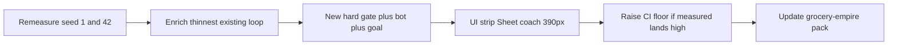

# Era expansion megaplan (B+B + UI throughout)

**Status:** Phases 0–6 **done** · **SAVE_VERSION** **26**  
**Authoritative verb names / UI north star:** Cursor plan `grocery_2.0_expansion` (supersedes older names below where they conflict).  
**Choices locked:** intentionally lengthen campaign toward **~40–50 h** Last Aisle; **one new hard-gated verb per era**; **UI overhaul in every phase**, not a polish pass at the end.

Also read: [00-agent-protocol.md](00-agent-protocol.md), [07-pacing.md](07-pacing.md), [09-ui.md](09-ui.md), [11-backlog.md](11-backlog.md).

## Thesis

Length comes from **sustained loops** (counts + cooldowns + ETAs + practice gaps), not sticker prices. Each era gains:

1. Enrich the thinnest existing loop on that door (so the bot cannot checkbox-skim).
2. One **new** hard-gated verb on the critical path (count + wait the bot cannot finish during another wait).
3. UI that matches the density contract: hub title, one primary, Sheet editors, Next Goal spine, coach target, 390 px.

## Target pacing (raise after loops prove it)

Do **not** raise asserts before the loop exists. After each band remeasures green above the old floor, update `pacing.test.ts`, [07-pacing.md](07-pacing.md), and `docs/2.0-plan.md` in the same change.

| Door | Today (seed 1) | Target window after expansion |
| --- | ---: | --- |
| Era 1 | ~26 min | **>35m ≤55m** |
| Era 2 | ~2.65 h | **>3.5h ≤5h** |
| Era 3 | ~6.3 h | **>8h ≤11h** |
| Era 4 | ~10.9 h | **>13h ≤16h** |
| Era 5 | ~14.6 h | **>17h ≤21h** |
| Era 6 | ~19.1 h | **>22h ≤27h** |
| Era 12 | ~32.2 h | **>40h ≤50h** (LONG_HORIZON) |

Worlds 7→12 today is only ~13 h after Continue. Most of the **+8–18 h** lands on hearing, phrases, circuits, seasons, and the new late verbs — not by bloating Era 0–6 past playability.

## Hard laws (never violate)

- UI only `dispatch(command)`. Upgrade strength via `upgradeEffect` / `upgradeMagnitude`.
- Economy in `sim/balance.ts` (`DEPTH` / `HORIZON` / `FLEET` / …).
- New state: `createInitialState` + `migrate.ts` + bump `SAVE_VERSION`.
- Teach campaign bot + Next Goal `action` in the **same** PR as every new gate.
- No new hub. No prestige rewrite. No multiply-all-costs. Never lower CI floors to pass red tests.
- Practice filings never open an era door. Museum wings stay 25 relics.
- Update this pack after every meaningful phase.

## UI contract (every phase)

Copy [09-ui.md](09-ui.md) density contract. Shared cleanup that runs **first**, then again as a check after each era band:

| Rule | Implementation |
| --- | --- |
| One title | Hub head + `ScreenHeader hub`; add `hub` to Worlds / Upgrades / Museum |
| One primary | `HorizonGoalStrip` or one CTA in `HubStage` primary |
| Editors in Sheet | Every width; no empty launcher cards |
| One number home | RoomHud **or** meter, not both |
| One guidance | Next Goal clause hint + `goalTarget` DEST; no new HelpCard essays |
| Coach | `data-coach-id`, `coachTargets.ts`, short stretch tour |
| Confirm | Kit `ConfirmProvider` only for new work |
| 390 px | Bottom sheet; smoke at 390 after each band |

**Shared UI phase 0 (do before era content):** unify World panels onto `hub` headers; move Invoice Book into a Sheet; sheet Empire doctrine / Autonomous; kill leftover HelpCards that restate Next Goal; delete or quarantine unused `DepartmentBands` if still dead code; fold `ConfirmModal` call sites toward kit confirms when touching a panel.

---

## Phase 0 — Baseline measure + shell UI

**Done 2026-11-14 (SAVE stays 21).** Default pacing green seeds 1/42; [07-pacing.md](07-pacing.md) refreshed. Phone bar promotes Empire + Worlds (`phoneBarHubs`); scene min-height raised; Invoice book Sheet; Worlds/Upgrades/Museum/`ScreenHeader hub`; Floor/Staff/Suppliers/Charter competing HelpCards gone; unused `DepartmentBands` deleted; Empire “≠ Upgrades” HelpCard removed.

**Exit:** Measured table refreshed; shell matches density contract. No CI assert raises.

---

## Phase 1 — Eras 0–1 (Counter → Corner) · SAVE **22**

**Committed redesigns** (supersede older hold/appointment names)

| Era | Verb | Home | Loop shape | Hard gate |
| --- | --- | --- | --- | --- |
| 0 | **Layaway slip** | Floor facing sheet | Deterministic visit skips auto-serve; player `serveRegular` before patience with shelf+facing | N slips for Era 1 (separate from `regularSatisfied`) |
| 1 | **Dock check-in** | Suppliers invoice sheet | Receiver on shift; `nextDockAt` cooldown; do **not** reuse upgrade id `dock-appointment` or revoke `invoicesOnTime` | Side-yard path needs N check-ins |

**Enrich:** regulars cast mid-30s (not the Era 1 clock).

**Balance:** measure then raise Era 1 CI → **35–55m**.

**UI:** Floor line + facing sheet; Suppliers invoice sheet hosts check-in; coach / `goalTarget` / clause hint.

**Done 2026-11-14.** SAVE 22: `layawaySlips` + `dockCheckIn` / `nextDockAt`; upgrade `dock-check-pad`; Era 1 CI **>35m ≤55m** (measured ~40.5m). Bot pushes `serveRegular` + `dockCheckIn`.

---

## Phase 2 — Eras 2–3 (Chain → Cold) · SAVE **23**

| Era | Verb | Home | Loop shape | Hard gate |
| --- | --- | --- | --- | --- |
| 2 | **Band lock** | Marketing flyer sheet | Flyer week credits only if featured prices held the printed band through live window; break voids week | Cold permit still reads `flyerWeeks` (quality of weeks) |
| 3 | **Hot-trait card** | Land | Fixed-gap block event (not `chance`); credit walk if a store policy matches `traitBias` before `until` | Cold permit needs N walks; leave-region unchanged |

**UI:** Flyer sheet band chips; Land callout + policy sheet; planogram → `PuzzleFrame` parity.

**Done 2026-11-14.** SAVE 23: flyer `bandHeld` + `hotTraitWalks` (fixed-gap block events); `openDaysNeedSideYard` 14; Era 2 CI **>3.5h ≤5h** (measured ~3.50h). Era 3 LONG window still pending remeasure after hot-trait walks prove length.

---

## Phase 3 — Eras 4–6 (Globe → Barges → Ration) · SAVE **24**

| Era | Verb | Home | Loop shape | Hard gate |
| --- | --- | --- | --- | --- |
| 4 | **Exam hold** | Logistics dispatch | `setManifest` locks mix; `swearExam` earns clean tick; miss slips cycle; never decrement `cleanManifests` | Berth reads exams + cleans |
| 5 | **Berth turnaround** | Fleet / Pocket | `restUntil` on hauler after arrival; concurrent stays 1 unless `upgradeEffect` | Era 6 reads turnarounds |
| 6 | **Ration ledger** | Floor + Books | One `stampLedger` per shift-day while stars frozen | **Continue** needs N stamps (fixes 6→7 0h) |

**UI:** Dispatch exam CTA; Pocket strip turnaround; Floor ledger → Books. Pocket concurrent as visible `upgradeEffect` nodes.

**CI:** Eras 4–6 → 13–16 / 17–21 / 22–27h.

---

## Phase 4 — Eras 7–9 (Worlds / Exchange / Cultivars) · SAVE **25**

| Era | Verb | Home | Loop shape | Hard gate |
| --- | --- | --- | --- | --- |
| 7 | **Climate neighbor** | Floor + Planets | Own slot (not shelf regulars); serve stocked world climate | Era 8 needs N served |
| 8 | **Stop settlement** | Exchange | Pending on **depth** after circuit credit; next convoy waits ETA; never hang fields on circuit rows (`circuitOf` drops them) | Settlements ≥ slow circuits |
| 9 | **Yield haul** | Cultivars + Fleet | Chore arms `haulUntil` on horizon; season still advances; miss → weak year | Era 10 reads hauls |

**UI:** `HorizonGoalStrip` only primary; settlement/haul sheets. Do not stall `seasonT`.

**Spot-check:** `LONG_HORIZON=1` before Phase 5.

---

## Phase 5 — Eras 10–12 (Signal / Charter / Last Aisle)

**New verbs**

| Era | Verb | Home | Loop shape | Hard gate |
| --- | --- | --- | --- | --- |
| 10 | **Relay watch** | Signal | Credited phrase stays credited only if agent finishes travel ETA to that world’s habit | Era 11 reads phrases that survived a watch |
| 11 | **Embassy reading** | Charter hearing sheet | Each kept clause seated at embassy on seal ETA; Concord files readings with inter-session **desk gap** | Era 12 needs N readings (raise above 3) with gap — hearing is no longer a checkbox |
| 12 | **List rehearsal** | Last Aisle | Practice fills before Accept credit (same practice/gap pattern as other Worlds layers) | Accept requires practice + mean 0.85; Reject path unchanged |

**Enrich:** `hearingNeeded*` up; Minutes Clerk amend clarity; phrase slow count; clause keep stays 4 unless design needs 5.

**Balance:** Last Aisle bot **>40h ≤50h**. Soft floor Era ≥ 11 still OK if 12 is the hard assert.

**UI:** Hearing docket as real session UI (not one sentence); List rehearsal mirrors `PuzzleFrame` practice; stakes line stays.

**SAVE:** bump for watch/reading/rehearsal fields.

**Exit:** `LONG_HORIZON=1` green at new Era 12 window.

---

## Phase 6 — Campaign polish + human feel

1. Full remeasure table seeds 1 and 42 for Era 1–2; seed 1 for LONG + LONG_HORIZON.
2. Museum relic drip for each new verb (25/wing).
3. Guide: short era blurbs only — no spoiler walls.
4. Final UI audit: every new sheet at 390 px; no second titles; Empire/Worlds/Floor smoke.
5. Quarantine debug pace tests; `npm test` / `lint` / `build` green.
6. Pack: update 05–11 + this file’s “done” checklist; README snapshot with new measured times and SAVE_VERSION.

---

## Per-verb engineering checklist (copy into every PR)

- [ ] `Command` + `can`/`run` in `commands*` / system file
- [ ] Fields in `state` + `createInitialState` + `migrate` + `SAVE_VERSION++`
- [ ] Constants in `balance.ts` (`DEPTH`/`HORIZON`/…)
- [ ] Hard gate on door (`unlocks` / memo / `leaveRegion` / `fleet` / `maybeOpenEras`)
- [ ] Goal in `goals.ts` with `action` bot can fire
- [ ] Bot branch in `bots.ts` (slow legal path)
- [ ] UI: strip or one-line status + Sheet editor; `hub` header; 390 px
- [ ] `goalTarget` DEST + Next Goal `clauseHint`
- [ ] Coach id + `coachTargets` + stretch tutorial step
- [ ] `wired.test` if upgrade nodes added
- [ ] Remeasure; raise CI only with rationale in 07 + 2.0-plan decision log
- [ ] Update this pack (05, 06, 07, 08, 09, 10, 11, README)

## Out of scope

- Seventh hub, Relocate/prestige rewrite, `break_eternity`, cost ×N, lowering floors, changing museum wing size, bundle code-split unless asked.

## Execution order for agents

One **phase** per working session (0 → 6). Inside a phase: enrich → new verb(s) → UI → measure → raise asserts → pack. Do not start Phase 5 until Phase 4’s LONG_HORIZON spot-check is green. If Era 1–2 upper bounds fail, teach the bot or shorten the new cooldown slightly — never delete the gate.
